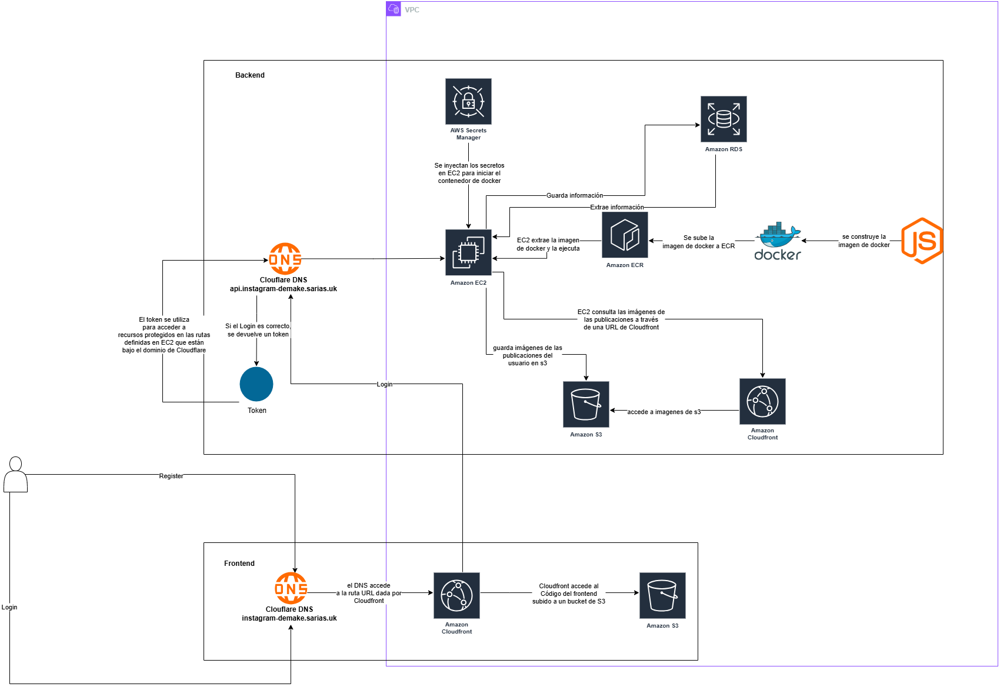

## 🚀 Demo en vivo

Visita la app en vivo

👉 [https://instagram-demake.sarias.uk](https://instagram-demake.sarias.uk)

## 🗺️ Diagrama de arquitectura en AWS
Este es el diagrama de despliegue de la página web Instagram Demake en AWS:

## 🎬 Funcionamiento de la aplicación

Mira cómo funciona la app en este video (click en la imagen):

# React + TypeScript + Vite

# "build": "tsc -b && vite build"

construye el proyecto de producción

tsc -b → Compila el código TypeScript en modo "build".
vite build → Construye la aplicación para producción usando Vite.

las variables de entorno de .env.production se incrustan durante el build en la aplicación

# "preview": "vite preview"

en el package.json se usa para previsualizar la versión generada (dist) tras un build de Vite.
